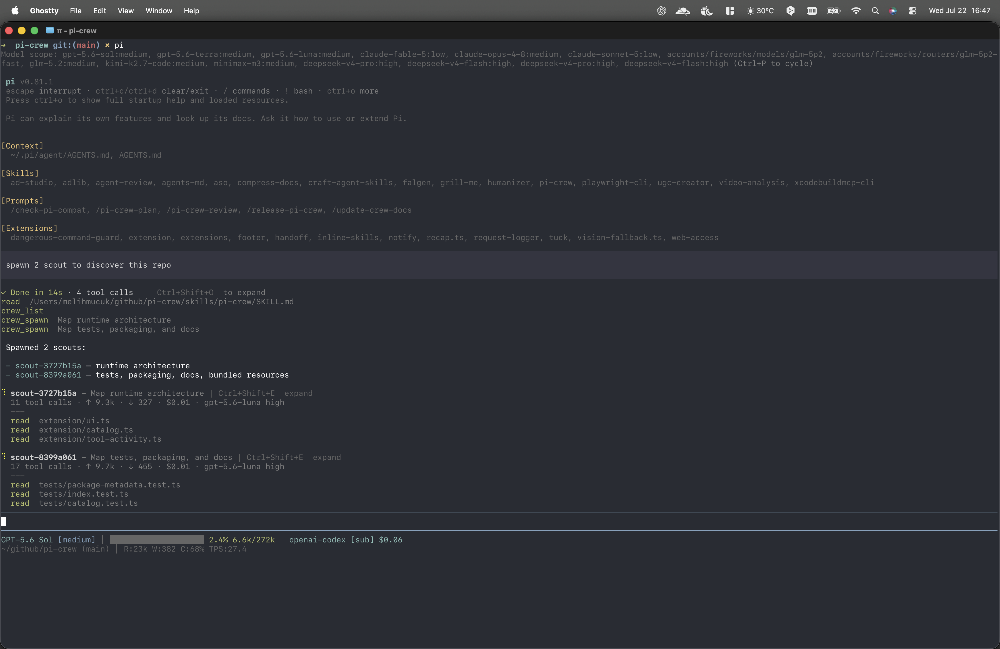

# pi-crew

Non-blocking subagent orchestration for [pi](https://pi.dev). Run isolated subagents in parallel while your current session stays interactive. Results return automatically to the session that started them.

## Preview



## Install

From npm:

```bash
pi install npm:@melihmucuk/pi-crew
```

From git:

```bash
pi install git:github.com/melihmucuk/pi-crew
```

This installs the extension, orchestration skill, prompt templates, and six bundled subagents. Requires Pi 0.84.3 or newer.

## Quick Start

Ask Pi to delegate a task:

```text
Ask @crew:scout to map the authentication flow and report the relevant files.
```

Or run a parallel review of your current changes:

```text
/pi-crew-review
```

Keep working while the subagents run. Results arrive automatically, and successful subagents stay available for follow-up until closed.

## Tools

| Tool | Purpose |
| ---- | ------- |
| `crew_list` | List agent names, role descriptions, models, and thinking levels; show owned active work with IDs, statuses, briefs, and working time. |
| `crew_spawn` | Start a subagent with a self-contained task; returns without waiting. |
| `crew_respond` | Answer a question or request a correction from a `completed` or `needs_input` subagent, not a running one. |
| `crew_done` | Close a subagent after its result is verified and no follow-up remains. |
| `crew_abort` | Cancel owned active subagents using `subagent_id`, `subagent_ids`, or `all: true`. |
| `crew_report` | Subagent-only: submit a result or request input. See [Result protocol](docs/result-protocol.md). |

Pi uses a short `brief` label and a structured task for each spawn:

```json
{
  "subagent": "scout",
  "brief": "map authenticated API endpoints",
  "task": {
    "goal": "All authenticated API endpoints and their authentication methods are identified.",
    "context": ["The user needs this inventory before changing the authorization model."],
    "instructions": [
      "Find every API endpoint and trace its authentication checks.",
      "Report relevant paths, symbols, relationships, and discovery gaps."
    ]
  }
}
```

`goal` describes the finished state. `context` carries facts unavailable in the repository, including binding user decisions and approved scope. `instructions` lists actions and execution constraints.

The bundled [pi-crew skill](skills/pi-crew/SKILL.md) guides task writing, splitting work, verification, and follow-ups. Expand a spawn call in the TUI to read its complete task.

## Mentions and Workflows

Type `@` to select a discovered subagent, such as `@crew:scout`, alongside Pi's file suggestions. A mention selects an agent; your sentence determines whether to delegate. Mention names support ASCII letters, digits, and hyphens.

- `/pi-crew-plan`: investigate with scouts, then ask a planner for a step-by-step implementation plan.
- `/pi-crew-review`: run correctness and maintainability reviews in parallel, verify their findings, and merge them into one report. Reviews current uncommitted changes unless you specify a scope.

Both workflows use bundled agents, so no extra definitions are needed.

## Bundled Agents

| Agent | Role |
| ----- | ---- |
| **scout** | Investigates a bounded question and returns evidence and relevant paths. |
| **planner** | Produces an implementation-ready plan without writing code. |
| **oracle** | Evaluates a decision and recommends a direction without making changes. |
| **code-reviewer** | Reviews correctness: bugs, security, data, and runtime behavior. |
| **quality-reviewer** | Reviews maintainability: duplication, complexity, and coupling. |
| **worker** | Implements scoped changes and verifies them. |

Read-only agents have `read` and `bash`; worker gets all built-in tools. Read-only behavior is an instruction-level contract, not a sandbox boundary.

## Customization

Definitions resolve in order: **project → user → bundled**. Higher-priority definitions with the same name win. Project definitions and config load only in trusted projects.

Create a custom agent in `.pi/agents/` or `~/.pi/agent/agents/` (Pi's default directories):

```markdown
---
name: api-scout
description: Maps API routes and their authentication checks without changing files.
tools: read, bash
---

Inspect the requested API scope and report paths and findings.
Do not modify files. Use bash only for read-only inspection.
```

Override settings without editing definitions using `.pi/pi-crew.json` or `~/.pi/agent/pi-crew.json`:

```json
{
  "agents": {
    "scout": {
      "model": "anthropic/claude-haiku-4-5",
      "tools": ["+custom_tool_name"]
    },
    "planner": { "thinking": "high" }
  }
}
```

Project fields override user fields. An omitted model inherits the owner's current model; an explicitly configured model must resolve exactly or spawning fails.

The `+` prefix adds a tool without replacing the existing list. Replace `custom_tool_name` with a tool provided by an extension loaded in the child session.

Ask Pi to create a custom agent using the [agent-writing workflow](skills/pi-crew/references/create-agent.md). See [Configuration](docs/configuration.md) for all frontmatter fields, tool and skill selection, override merging, and tool deltas.

## Results and Sessions

- **✅ `completed`**: Pi verifies the report, requests corrections if needed, then closes the subagent with `crew_done`.
- **⏳ `needs_input`**: the subagent is waiting for an answer. Pi supplies it or asks you, then continues with `crew_respond`.
- **Error or abort**: the subagent session is disposed; successful results are never fabricated.

Results arrive automatically; no polling is needed. Switching sessions preserves background work; `/fork` and `/clone` transfer it to the new session. Quitting Pi aborts active subagents. See [delivery and session rules](docs/result-protocol.md#owner-delivery) for queued results and reload behavior.

The status widget shows model, working time, tokens, cost, call counts, and recent tool activity. Waiting time does not count as working time. Press `Ctrl+Shift+E` to toggle activity details. Expand result cards to read the full report and open the child session.

To hide tool-activity rows, put this in `pi-crew.json` and reload:

```json
{ "widget": { "showToolCalls": false } }
```

Status and usage totals remain visible; execution and recording are unchanged.

## Documentation

- [Configuration](docs/configuration.md): discovery, custom agents, overrides, and widget settings.
- [Result protocol](docs/result-protocol.md): report validation, lifecycle, message delivery, and TUI/model-context separation.
- [Orchestration skill](skills/pi-crew/SKILL.md): how Pi delegates and integrates work.

## Acknowledgments

Inspired by these projects:

- [pi-subagents](https://github.com/nicobailon/pi-subagents) by [@nicobailon](https://github.com/nicobailon)
- [pi-interactive-subagents](https://github.com/HazAT/pi-interactive-subagents) by [@HazAT](https://github.com/HazAT)

## License

MIT
